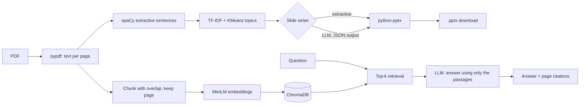

# DocDeck-AI

Turn a PDF into a slide deck, or ask it questions and get answers with page citations.

Started as an extractive NLP summarizer (spaCy + TF-IDF/KMeans). Now it also has an
LLM slide writer, a RAG question-answering tab, a REST API and an evaluation harness.

## Architecture



## Features

- **Generate slides** from any text PDF, two modes:
  - *Extractive*: no API key; your original spaCy scoring and KMeans topics.
  - *LLM-written*: one LLM call per topic cluster returns `{title, bullets}` as JSON,
    grounded only in that cluster's sentences. Invalid JSON is retried once, then falls back
    to extractive text (flagged in the UI).
- **Ask the document (RAG)**: chunking with overlap (never crossing pages), local
  `all-MiniLM-L6-v2` embeddings, ChromaDB cosine search, and an LLM prompt that must cite
  `[p. N]` or say it can't find the answer.
- **REST API** (FastAPI): `POST /summarize`, `POST /documents`, `POST /ask`, `GET /health`.
- **Evaluation**: ROUGE for slide text, hit@k and MRR for retrieval, chunk-size comparison.
- **Tests**: 16 offline tests (fake embedder + fake LLM, no API key needed).

## Setup

```bash
python -m venv .venv && source .venv/bin/activate     # Windows: .venv\Scripts\activate
pip install -r requirements.txt
cp .env.example .env        # then set LLM_API_KEY, LLM_BASE_URL, LLM_MODEL
```

## Run

```bash
streamlit run app.py                 # web UI
uvicorn api:app --reload             # API, interactive docs at http://127.0.0.1:8000/docs
pytest -q                            # tests
```

API example:

```bash
curl -F file=@docs/sample.pdf -F mode=extractive http://127.0.0.1:8000/summarize
curl -F file=@docs/sample.pdf http://127.0.0.1:8000/documents          # -> {"doc_id": "..."}
curl -X POST http://127.0.0.1:8000/ask -H "Content-Type: application/json" \
     -d '{"doc_id": "<doc_id>", "question": "What is a subsidy?", "k": 4}'
```

## Evaluation

`eval/questions.json` holds 28 questions about one test PDF (factual, list, numeric, table,
paraphrased and misspelled), each with a verified evidence phrase and page.
`eval/out_of_doc.json` holds 9 questions the PDF cannot answer (3 unrelated, 6 close to the topic).

```bash
# 1. retrieval quality and chunk size (equal text per query makes the comparison fair)
python -m eval.eval_retrieval --pdf docs/my.pdf --questions eval/questions.json --chunk-words 100 180 300 --k 5 --by-type
python -m eval.eval_retrieval --pdf docs/my.pdf --questions eval/questions.json --chunk-words 100 180 300 --context-words 600

# 2. refusals: similarity cutoff (no API key) and real LLM behaviour (--llm)
python -m eval.eval_abstention --pdf docs/my.pdf --questions eval/questions.json --out-of-doc eval/out_of_doc.json --llm

# 3. slide quality (needs PDFs with human-written reference summaries)
python -m eval.eval_summaries --docs eval/docs --ratio 0.2 --topics 5 --skip-pages 1
```

Set `RAG_MIN_SCORE` in `.env` to the suggested cutoff to skip the LLM call on questions the
document clearly cannot answer.

Results (fill in with your own runs; do not publish numbers you did not measure):

| chunk_words | k | hit@1 | hit@3 | hit@k | MRR |
|---|---|---|---|---|---|
| 100 | | | | | |
| 180 | | | | | |
| 300 | | | | | |

| refusal test | result |
|---|---|
| out-of-doc questions refused | /9 |
| in-doc questions wrongly refused | /28 |
| suggested RAG_MIN_SCORE | |

| system | ROUGE-1 | ROUGE-2 | ROUGE-L |
|---|---|---|---|
| extractive | | | |
| LLM-written | | | |

## Design decisions

- Chunks stay inside one page so each retrieved passage has exactly one citation.
- The LLM only rewrites sentences already selected by the extractive stage, which keeps
  cost low and limits hallucination.
- The LLM client uses the OpenAI SDK against any OpenAI-compatible endpoint, so the provider
  is a config change, not a code change.
- `.pptx` files are built in memory and returned as bytes (no temp files).

## Limitations

- Scanned (image-only) PDFs have no text layer; OCR is not included.
- Extractive scoring favours frequent words; ROUGE penalises good paraphrases.
- The API keeps indexes in memory, so they are lost on restart (demo-grade).
- Optional: put an `organic_template.pptx` next to `app.py` to use your own slide theme.
