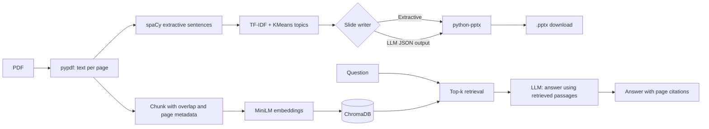

# DocDeck-AI

Turn a PDF into a slide deck, or ask questions about it and get answers with page citations.

DocDeck-AI started as an extractive NLP summarizer using spaCy, TF-IDF, and KMeans. It has since evolved into a document-processing application with LLM-powered slide generation, retrieval-augmented question answering (RAG), a REST API, and an evaluation harness.

## Architecture



## Features

### 1. PDF-to-PowerPoint Generation

Generate presentations from text-based PDF documents using two modes:

- **Extractive:** Uses spaCy sentence processing, TF-IDF scoring, and KMeans topic clustering. No LLM API key is required.
- **LLM-written:** Makes one LLM call per topic cluster to generate slide titles and bullet points in JSON format. The LLM is restricted to sentences selected by the extractive pipeline.
- **Fallback handling:** Invalid JSON is retried once before falling back to extractive text. The fallback is flagged in the UI.
- **PowerPoint export:** Generates downloadable `.pptx` files using `python-pptx`.

### 2. Document Question Answering (RAG)

- Extracts text and page numbers from PDFs.
- Splits text into overlapping chunks without crossing page boundaries.
- Generates local embeddings using `all-MiniLM-L6-v2`.
- Stores and searches embeddings using ChromaDB cosine similarity.
- Retrieves the most relevant passages for each question.
- Uses an LLM to answer using retrieved context and provide page citations in the form `[p. N]`.
- Supports abstention when the document does not contain sufficient information.

### 3. REST API

Built with FastAPI, with the following endpoints:

| Endpoint | Purpose |
|---|---|
| `POST /summarize` | Generate a PowerPoint from a PDF |
| `POST /documents` | Index a PDF for question answering |
| `POST /ask` | Ask a question about an indexed document |
| `GET /health` | Check API health |

### 4. Evaluation Harness

The project includes evaluation scripts for:

- Retrieval quality using Hit@1, Hit@3, Hit@k, and MRR.
- Comparing different chunk sizes and context-window configurations.
- Evaluating abstention on in-document and out-of-document questions.
- Comparing extractive and LLM-written summaries using ROUGE metrics.

### 5. Automated Tests

The project includes 16 offline tests using fake embedding and LLM implementations, allowing core functionality to be tested without an API key.

## Setup

Create and activate a virtual environment.

```powershell
python -m venv .venv
.venv\Scripts\Activate.ps1
```

Install dependencies:

```bash
pip install -r requirements.txt
```

Create your environment file from the example:

```powershell
Copy-Item .env.example .env
```

Configure the required LLM settings in `.env`:

```dotenv
LLM_API_KEY=your_api_key
LLM_BASE_URL=your_openai_compatible_endpoint
LLM_MODEL=your_model_name
```

Set `RAG_MIN_SCORE` after running the abstention evaluation. Use the measured recommendation rather than an arbitrary threshold.

## Run the Application

Launch the Streamlit interface:

```bash
streamlit run app.py
```

Start the FastAPI server:

```bash
uvicorn api:app --reload
```

Interactive API documentation is available at:

`http://127.0.0.1:8000/docs`

Run the test suite:

```bash
pytest -q
```

## API Examples

Generate a presentation using extractive mode:

```bash
curl -F file=@docs/sample.pdf \
     -F mode=extractive \
     http://127.0.0.1:8000/summarize
```

Index a PDF for question answering:

```bash
curl -F file=@docs/sample.pdf \
     http://127.0.0.1:8000/documents
```

The response includes a `doc_id` that can be used for subsequent questions.

Ask a question about the indexed document:

```bash
curl -X POST http://127.0.0.1:8000/ask \
     -H "Content-Type: application/json" \
     -d '{"doc_id": "<doc_id>", "question": "What is a subsidy?", "k": 4}'
```

## Evaluation

### Evaluation Dataset

The retrieval evaluation uses `eval/questions.json`, containing 28 questions about a test PDF. The questions cover factual, list-based, numeric, table-based, paraphrased, and misspelled queries. Each question has a verified evidence phrase and page number.

The test document, `FME_MID_1.pdf`, contains 18 pages and approximately 6,841 words.

The file `eval/out_of_doc.json` contains nine questions that the document cannot answer: three unrelated questions and six questions closely related to the document's subject.

### Retrieval Quality

The following results were measured using 28 questions and `k=5`.

| Chunk Size (words) | k | Chunks | Hit@1 | Hit@3 | Hit@k | MRR |
|---:|---:|---:|---:|---:|---:|---:|
| 100 | 5 | 112 | 0.57 | 0.64 | 0.75 | 0.63 |
| 180 | 5 | 53 | 0.61 | 0.71 | 0.96 | 0.71 |
| 300 | 5 | 34 | 0.54 | 0.89 | 0.96 | 0.73 |

**Key findings:**

- The 180-word configuration achieved the highest Hit@1 score of `0.61`.
- The 300-word configuration achieved the highest Hit@3 score of `0.89` and MRR of `0.73`.
- Both the 180-word and 300-word configurations achieved a Hit@k score of `0.96`.
- The 100-word configuration achieved a Hit@k score of `0.75`, indicating lower retrieval coverage at the same `k`.

The results suggest that larger chunks can improve the likelihood of retrieving supporting evidence within the top results, while smaller chunks may provide more focused first-ranked passages.

### Context-Window Experiment

A separate experiment used the `--context-words 600` option.

| Chunk Size (words) | k | Chunks | Hit@1 | Hit@3 | Hit@k | MRR |
|---:|---:|---:|---:|---:|---:|---:|
| 100 | 6 | 112 | 0.57 | 0.64 | 0.79 | 0.64 |
| 180 | 3 | 53 | 0.61 | 0.71 | 0.71 | 0.65 |
| 300 | 2 | 34 | 0.54 | 0.86 | 0.86 | 0.70 |

The 300-word configuration achieved the highest MRR in this experiment, at `0.70`. However, the configurations used different reported values of `k`, so this is not a controlled comparison at a fixed retrieval count.

### Retrieval Metrics

- **Hit@1:** Fraction of questions for which the correct evidence chunk ranks first.
- **Hit@3:** Fraction of questions for which the correct evidence chunk appears among the first three results.
- **Hit@k:** Fraction of questions for which the correct evidence chunk appears among the top-k results.
- **MRR:** Mean Reciprocal Rank, measuring how highly the first correct evidence chunk is ranked.

Higher values indicate better retrieval performance.

### Question-Type Analysis

The evaluation also measures retrieval performance across six question categories.

| Question Type | Count | Best Observed Hit@1 | Best Observed Hit@3 | Best Observed Hit@k |
|---|---:|---:|---:|---:|
| Factual | 11 | 1.00 (100-word chunks) | 1.00 | 1.00 |
| List | 6 | 0.50 (180/300 words) | 0.83 (300 words) | 1.00 (180/300 words) |
| Numeric | 3 | 0.33 (all sizes) | 1.00 (300 words) | 1.00 (180/300 words) |
| Paraphrase | 3 | 0.67 (180 words) | 1.00 (180/300 words) | 1.00 (180/300 words) |
| Table | 2 | 0.00 (all sizes) | 0.50 (300 words) | 1.00 (180/300 words) |
| Typo | 3 | 0.67 (100/300 words) | 0.67 (all sizes) | 0.67 (all sizes) |

The category results suggest that straightforward factual questions are handled well, while table-based questions remain challenging at rank one. These results should be interpreted cautiously because some categories contain only two or three questions.

### Reproducing the Evaluation

Run the retrieval comparison:

```bash
python -m eval.eval_retrieval \
  --pdf eval/docs/FME_MID_1.pdf \
  --questions eval/questions.json \
  --chunk-words 100 180 300 \
  --k 5 \
  --by-type
```

Run the context-window experiment:

```bash
python -m eval.eval_retrieval \
  --pdf eval/docs/FME_MID_1.pdf \
  --questions eval/questions.json \
  --chunk-words 100 180 300 \
  --context-words 600
```

Evaluate abstention and the suggested confidence threshold:

```bash
python -m eval.eval_abstention \
  --pdf eval/docs/FME_MID_1.pdf \
  --questions eval/questions.json \
  --out-of-doc eval/out_of_doc.json \
  --llm
```

Evaluate summary quality:

```bash
python -m eval.eval_summaries \
  --docs eval/docs \
  --ratio 0.2 \
  --topics 5 \
  --skip-pages 1
```

### Refusal Evaluation

The following metrics have not yet been measured.

| Refusal Test | Result |
|---|---|
| Out-of-document questions correctly refused | Pending / 9 |
| In-document questions incorrectly refused | Pending / 28 |
| Suggested `RAG_MIN_SCORE` | Pending evaluation |

The confidence threshold is intended to skip the LLM call when retrieval scores indicate that the document is unlikely to contain the answer. The final threshold should be chosen using measured results from both in-document and out-of-document questions.

### Summary Quality Evaluation

ROUGE evaluation requires human-written reference summaries for the evaluated documents.

| System | ROUGE-1 | ROUGE-2 | ROUGE-L |
|---|---|---|---|
| Extractive | Pending evaluation | Pending evaluation | Pending evaluation |
| LLM-written | Pending evaluation | Pending evaluation | Pending evaluation |

These scores have not yet been measured and are intentionally left blank rather than estimated.

## Design Decisions

### 1. Page-Aware Chunking

Chunks never cross page boundaries. This keeps the source page associated with each retrieved passage, allowing the application to provide page-level citations.

### 2. Hybrid Extractive and Generative Summarization

The extractive pipeline selects relevant sentences and groups them into topics. The LLM rewrites only the selected sentences, limiting the input context and helping keep generated slides grounded in the source document.

### 3. Configurable LLM Provider

The application uses the OpenAI SDK with an OpenAI-compatible endpoint. The provider and model can be changed through environment variables without rewriting the application logic.

### 4. In-Memory PowerPoint Generation

PowerPoint files are generated using `python-pptx` in memory and returned as bytes. This avoids creating temporary presentation files on disk.

### 5. Evaluation-Driven Retrieval Tuning

Chunk size and retrieval parameters are evaluated against questions with verified evidence phrases and page numbers. The measured results help identify a suitable retrieval configuration instead of relying only on subjective testing.

## Limitations

- **Scanned PDFs:** Image-only PDFs are not supported because OCR is not included.
- **Extractive summarization:** TF-IDF scoring can favour frequently occurring terms and may miss important context.
- **ROUGE limitations:** ROUGE can penalize semantically correct paraphrases that differ from the reference wording.
- **Retrieval limitations:** The evaluation contains only 28 questions from one test document, so the results do not establish performance across all PDF types.
- **Table extraction:** Table-based questions remain challenging, especially when the relevant evidence is split across extracted text or poorly structured tables.
- **In-memory indexing:** Document indexes are lost when the API process restarts.
- **LLM dependence:** LLM-written slides and generated answers require a configured, reachable LLM endpoint.
- **Optional slide theme:** Place an `organic_template.pptx` file next to `app.py` to use a custom presentation theme.

## Future Improvements

- Evaluate retrieval on additional PDFs and larger question sets.
- Experiment with chunk overlap, reranking, and hybrid keyword-plus-vector retrieval.
- Improve PDF table extraction and numeric question handling.
- Complete refusal evaluation and tune `RAG_MIN_SCORE`.
- Measure ROUGE scores using human-written reference summaries.
- Add persistent storage for document indexes.
- Improve answer evaluation by checking factual correctness and citation accuracy.

## Conclusion

DocDeck-AI combines extractive and LLM-based presentation generation with document-grounded question answering and page citations.

In the initial retrieval evaluation, using 28 questions from an 18-page PDF, 180-word chunks achieved the highest Hit@1 (`0.61`), while 300-word chunks achieved the highest MRR (`0.73`). Both configurations reached a Hit@k of `0.96` at `k=5`.

These measurements provide an initial retrieval baseline for the project. Refusal accuracy and ROUGE-based summary quality remain pending further evaluation.
